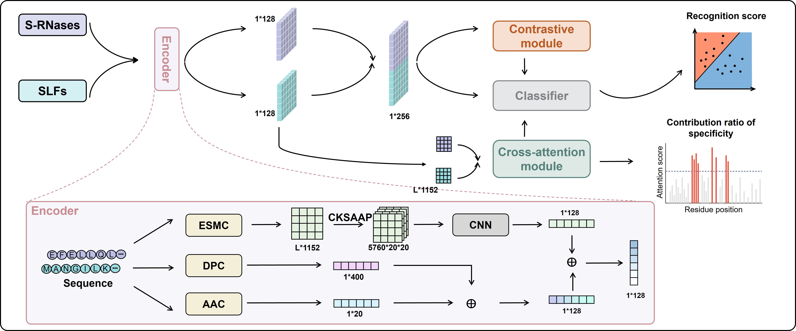

# DeepSPY

DeepSPY predicts S-RNase–SLF recognition specificity from protein sequences and prioritizes candidate residues for experimental follow-up. This repository contains the software, curated pair identifiers, fixed five-fold splits and configuration files. Trained checkpoints, feature caches, numerical source data and molecular-simulation outputs are provided separately in the companion [Zenodo data archive](https://zenodo.org/) (the record DOI is pending publication; the link will be updated to the specific record).



## Repository and data layout

- `deepspy/`: model, feature preparation, training and prediction code.
- `configs/`: experiment settings, including the fixed benchmark and performance protocols.
- `data/`: curated pair and sequence tables plus the ordered fold assignments.
- `baselines/`: classical machine-learning baseline implementation and configuration.
- `docs/artifact_rights.md`: redistribution considerations for non-code artifacts.

## Quick start

The steps below run the released `PhS3_PhS9-SLF1` example. The GitHub repository supplies the code; the companion Zenodo deposit supplies the pretrained checkpoint and cached features. 
### 1. Get the code

Clone the [DeepSPY GitHub repository](https://github.com/herherw/DeepSPY) and enter its root directory:

```bash
git clone https://github.com/herherw/DeepSPY.git
cd DeepSPY
```

### 2. Install DeepSPY

Use Python 3.12 to match the reported environment. From the repository root, check the active Python and install this checkout:

```bash
python --version
python -m pip install .
```

The `python -m pip install .` command installs DeepSPY and its listed dependencies into the active environment.

### 3. Run the example

From the companion [Zenodo data archive](https://zenodo.org/), download both`inputs_and_features.tar.gz` and `checkpoints_case.tar.gz`. Place the downloaded files in the `DeepSPY` repository root, and run:

```bash
tar -xzf inputs_and_features.tar.gz
tar -xzf checkpoints_case.tar.gz
```

Extract into the repository root, keeping the paths stored in the archives. After extraction, `data/examples/protein1.fasta`, `data/examples/protein2.fasta`, `artifacts/features/` and `artifacts/checkpoints/case/` should exist.

Run this command from the repository root with the same Python environment used for installation:

```bash
python -m deepspy.case --config configs/case.yml --checkpoint artifacts/checkpoints/case/fold_1_epoch_45.pkl --output prediction_results/example
```

The included features are already computed, so this example does not require downloading an upstream ESM-C model. For new protein sequences, install the optional ESM-C dependency with `python -m pip install ".[esmc]"` and follow the upstream model's access and license terms. Cached-feature predictions use the released feature archive instead.

## Train new models

To train DeepSPY again on the curated pairs, first complete Quick start steps 1–2 . The training code needs the pair table, saved five-fold splits and precomputed feature files. From the repository root, check that the pair labels and saved fold assignments are consistent:

```bash
deepspy-train --config configs/benchmark.yml --validate-only
```

This check does not load or verify every feature file. Start the full five-fold benchmark training run with:

```bash
deepspy-train --config configs/benchmark.yml
```

Each command trains five models using the saved train/test pair splits. It automatically uses a CUDA GPU if available, otherwise the CPU. Existing runs are not overwritten.


## Citation and license

Use [CITATION.cff](CITATION.cff) for software citation. Once the Zenodo record is published, cite its **data DOI** separately when using the checkpoints or source data. The original software is licensed under [Apache-2.0](LICENSE). Dataset, feature and third-party redistribution rights are discussed in [docs/artifact_rights.md](docs/artifact_rights.md); the software license does not automatically cover those artifacts.
